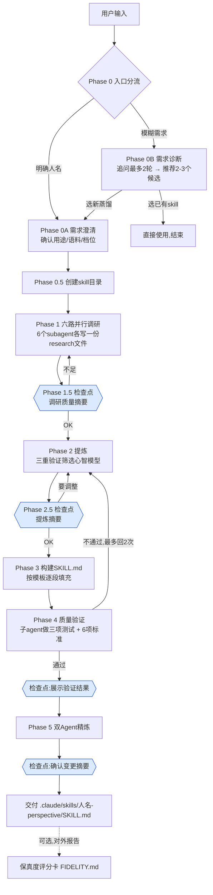
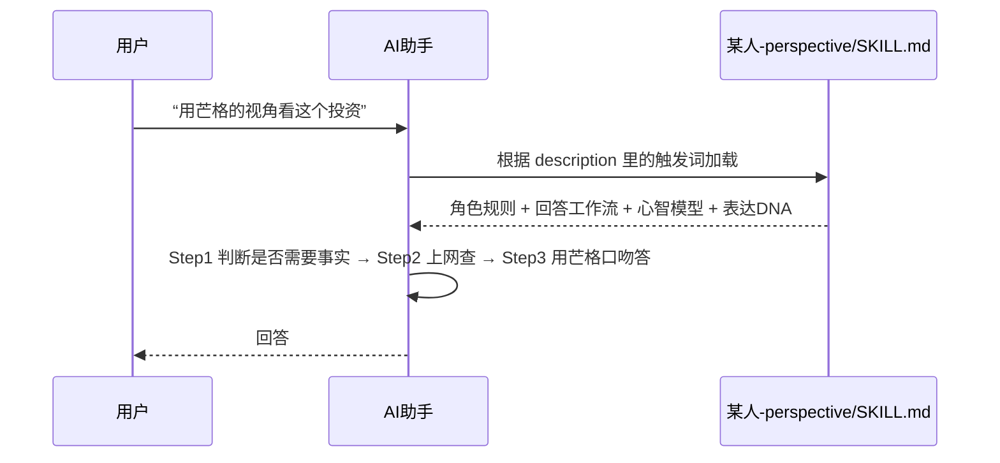

# 00 · 全景图：这个仓库到底是什么

> 本文回答三个问题：仓库里有什么？每样东西干什么用？整件事是怎么串起来的？
> 标注约定：`路径:行号` 是依据；（推测）表示仓库没明说、由我推断。

## 先用一句话说清楚

nuwa-skill（女娲）**不是一个传统软件**，它是一份写给 AI 看的“工作手册”。你把手册交给一个 AI 助手（如 Claude Code），再说一句“蒸馏芒格”，AI 就会照着手册去：上网查资料 → 提炼这个人的思维方式 → 写出一份新的、可以扮演此人视角的手册。依据：`SKILL.md:11-26`、`README.md:262-272`。

几个名词先讲清楚：

- **Skill（技能）**：一个文件夹，核心是一份叫 `SKILL.md` 的 Markdown 文件，开头有一小段元数据（名字、什么时候触发），后面是给 AI 的指令。AI 在合适的时候会读它并照做。依据：`SKILL.md:1-9`、`README.md:142`。
- **提示词（prompt）**：写给 AI 的文字指令。本仓库 90% 以上的内容是提示词，不是程序。
- **蒸馏**：这里指把一个人公开留下的大量文字/视频，浓缩成“他怎么想问题”的一套规则，而不是复制他说过的话。依据：`SKILL.md:26`（“捕捉的是HOW they think，不是WHAT they said”）。
- **Subagent（子代理）**：主 AI 临时派出去干活的“分身”，各干各的，互不干扰。依据：`SKILL.md:220`。

## 目录树与职责

```
nuwa-skill/
├── SKILL.md                    女娲本体：整套流程的“总指挥手册”（682 行）
├── references/                 总指挥手册要“按需翻阅”的三份参考
│   ├── extraction-framework.md   提炼方法论：三重验证、表达DNA量化、矛盾处理、自检清单
│   ├── skill-template.md         新 skill 的空白模板（含角色扮演规则、各章节骨架）
│   └── fidelity-scorecard.md     “保真度评分卡”：交付后的质检方法（100 分制）
├── scripts/                    4 个辅助脚本，只做机械活
│   ├── download_subtitles.sh     用 yt-dlp 下载 YouTube 字幕
│   ├── srt_to_transcript.py      把字幕清洗成纯文本
│   ├── merge_research.py         统计 6 份调研的来源数，打印“调研摘要表”
│   └── quality_check.py          用正则检查 SKILL.md 是否达标（6 项）
├── examples/                   15 个已做好的成品，附完整调研底稿
│   └── <人物>-perspective/       SKILL.md + FIDELITY.md + references/（调研）
├── README.md（+ EN/ES/JA/KO）  项目介绍；非中文版本是翻译版（推测：未逐字比对）
├── CONTRIBUTING.md             贡献规则：SKILL.md 不收外部 PR
├── COMMUNITY.md                社区作品索引
├── .github/                    一个自动检查“收录申请”的 GitHub 机器人
│   ├── workflows/community-pr-check.yml
│   └── scripts/community_check.py
├── assets/ promo/ *.png        宣传图、动画、PDF（与方法论无关）
├── x-thread-en.md              英文推文串草稿（宣传文案）
└── LICENSE                     MIT 许可证
```

依据：`find` 列出的文件清单；各文件职责来自其文件头或正文，逐项见下表。

| 路径 | 职责 | 依据 |
|---|---|---|
| `SKILL.md` | 定义 Phase 0 到 Phase 5 的全流程、失败降级表、反模式黑名单 | `SKILL.md:30-623` |
| `references/extraction-framework.md` | “心智模型”筛选标准（三重验证）和质量自检清单 | `references/extraction-framework.md:5-34,124-151` |
| `references/skill-template.md` | 新 skill 长什么样：角色扮演规则、身份卡、模型、启发式、表达DNA、诚实边界… | `references/skill-template.md:7-117` |
| `references/fidelity-scorecard.md` | 五个维度打分，要求“答题 agent 与评分 agent 必须分开” | `references/fidelity-scorecard.md:5-11,158-166` |
| `scripts/download_subtitles.sh` | 下字幕：先中文人工字幕，再英文，再自动字幕 | `scripts/download_subtitles.sh:1-5` |
| `scripts/srt_to_transcript.py` | 去时间戳、序号、HTML 标签、连续重复行 | `scripts/srt_to_transcript.py:2-3` |
| `scripts/merge_research.py` | 数 URL、数“一手/二手”关键词，打印检查点表格 | `scripts/merge_research.py:2-4` |
| `scripts/quality_check.py` | 6 项正则检查（模型数量、局限、DNA、边界、张力、一手占比） | `scripts/quality_check.py:116-123` |
| `examples/*` | 成品展示；每个目录都能复制到 skills 目录直接用 | `README.md:284-300` |
| `CONTRIBUTING.md` | “`SKILL.md` 是核心资产，不接受外部PR改动” | `CONTRIBUTING.md:5-7` |
| `.github/scripts/community_check.py` | 自动检查 COMMUNITY.md 的收录 PR（分数≥70 等） | `.github/scripts/community_check.py:1-20` |

**关于 `examples/` 的补充事实**：共 15 个目录（14 个人物 + 1 个主题 `x-mastery-mentor`）。README 的目录树注释和英文小结写“13个人物 + 1个主题”（`README.md:284,376`），而同一文件的“已蒸馏人物”写“14位人物 + 1个主题”（`README.md:194`），英文版也是 14 + 1（`README_EN.md:162`）——数字有出入，属于文档更新不同步（推测：作者新增了人物但没改所有计数）。

## 整体流程图

下图把 `SKILL.md` 的执行流程画出来。蓝色的“检查点”是需要停下来请用户确认的地方（依据 `SKILL.md:334,413,557,578` 的 🔴 CHECKPOINT 标记）。



要点：

1. **有三个回环**：调研不足回 Phase 1；提炼不对回 Phase 2；验证不过回 Phase 2（上限 2 次，`SKILL.md:555`）。
2. **“保真度评分卡”不在主流程里**。`references/fidelity-scorecard.md:205-207` 明说：Phase 4 是“内部质检”，评分卡是“出厂检验的对外报告”。
3. **README 说“四件事”，SKILL.md 实际有六个以上的阶段**。README 的“工作原理”只写了四步（`README.md:262-270`），而 `SKILL.md` 还有入口分流、建目录、两个检查点和 Phase 5 精炼。这个差别在 `01` 篇详细对照。

## 一份 skill 是怎么“被使用”的



“根据 description 触发词加载”这一机制，在 `SKILL.md:1-9` 的 frontmatter 和 `SKILL.md:443`（description 要控制在 1024 字内）中可见；加载细节由具体 AI 运行环境决定，仓库没有展开（推测）。

## 一个重要的“不是什么”

- 仓库**没有**任何调用 AI 接口的代码、没有服务器、没有数据库。4 个脚本只处理字幕和做文本检查，不联网搜索资料——搜索是 AI 助手自己的工具（如 WebSearch）完成的（`SKILL.md:486` 提到“必须使用工具（WebSearch等）”）。
- 因此“女娲效果好不好”，几乎完全取决于：① 提示词写得如何，② 运行它的 AI 够不够强。仓库本身无法保证效果（推测，但由上面两点直接推出）。

下一篇：[01-四阶段流程拆解](01-四阶段流程拆解.md)
